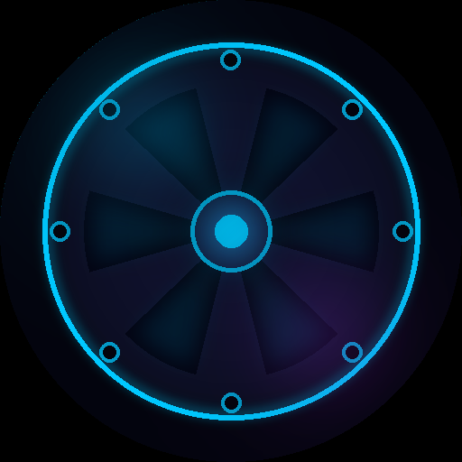
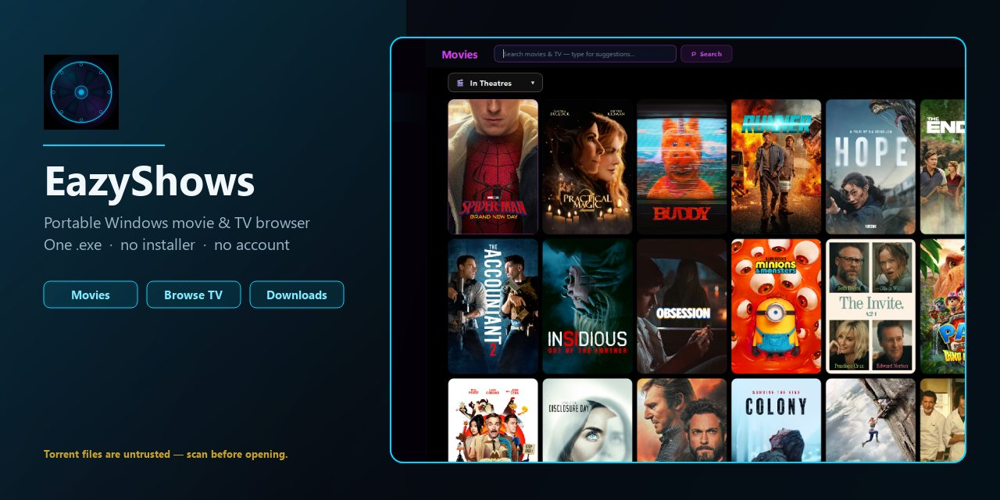
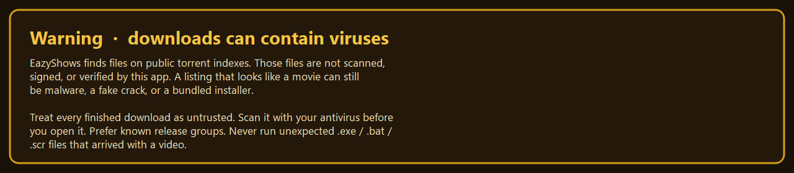
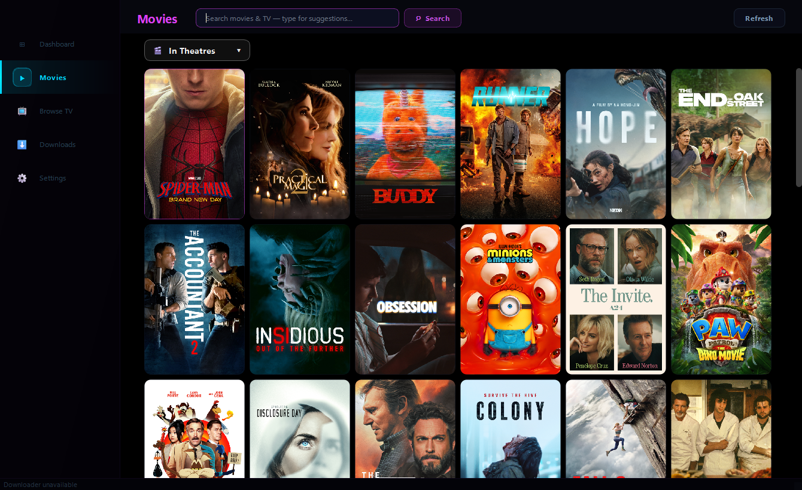
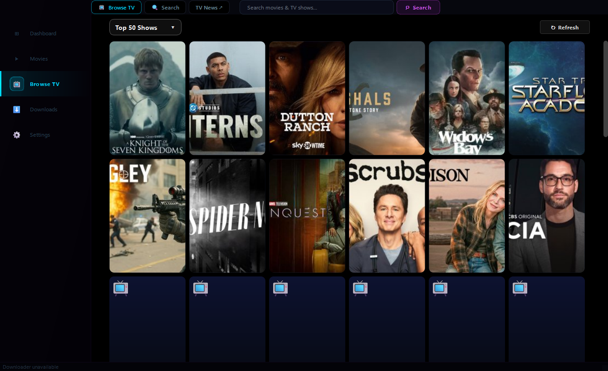
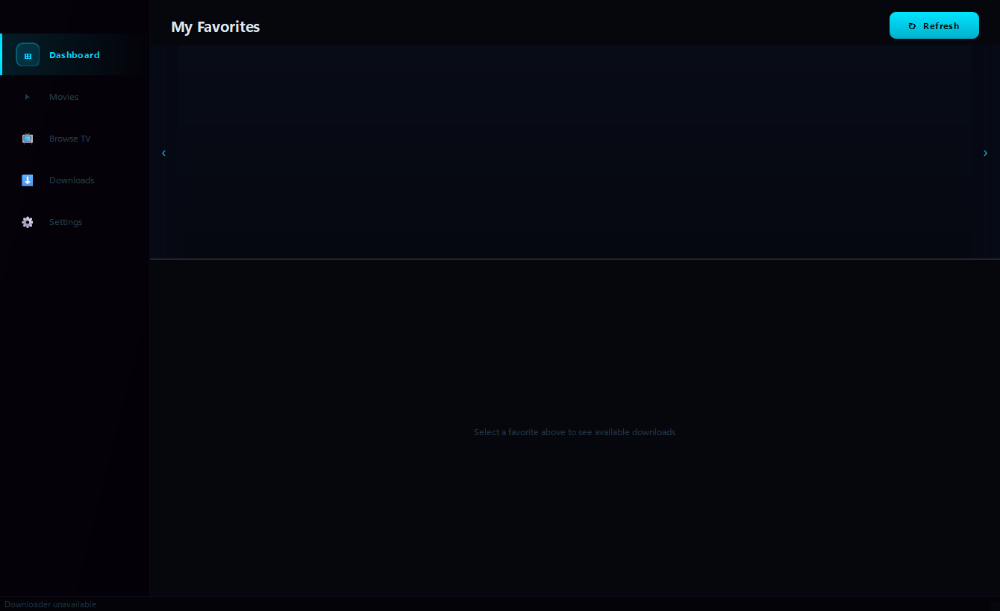
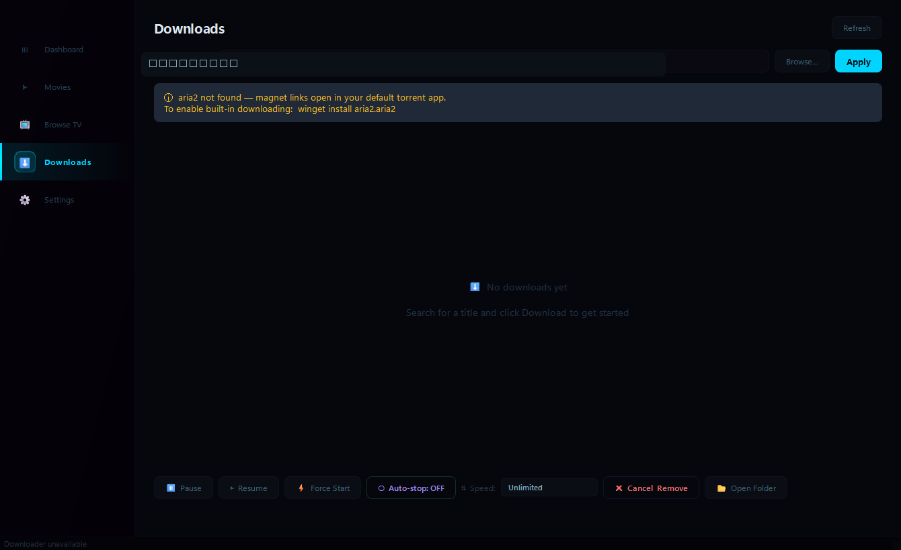
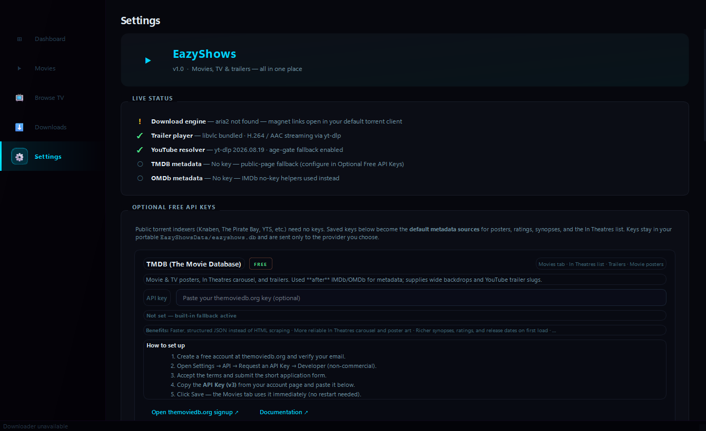
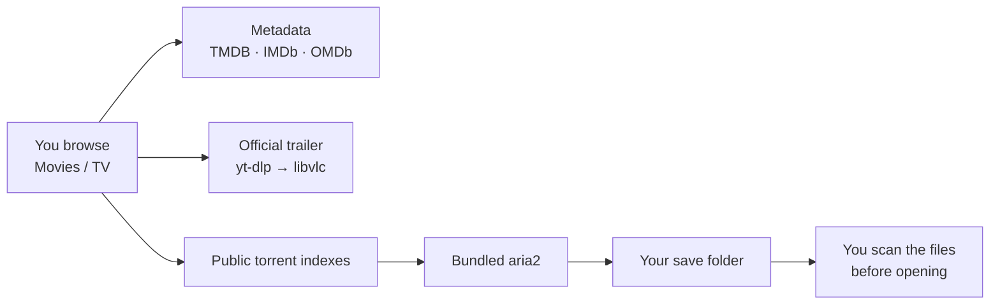

<div align="center">



# EazyShows

**A portable Windows movie & TV browser.**  
Netflix-style desktop UI. One double-clickable `EazyShows.exe`. No installer, no Python, nothing to set up.

<p>
  <a href="https://github.com/Jew4200/EazyShows-releases/releases/latest"><strong>Download the latest EazyShows.exe</strong></a>
</p>


<br>



</div>

> [!CAUTION]
> ### Downloads in this app can contain viruses
> EazyShows finds files on **public torrent indexes**. Those files are **not scanned, signed, or verified** by the app. A listing that looks like a movie can still be malware, a fake crack, or an installer sitting next to a video.
>
> **Treat every finished download as untrusted.** Scan it with Windows Defender (or your antivirus) before you open it. Prefer `.mkv` / `.mp4`. Never run unexpected `.exe`, `.bat`, or `.scr` files that arrived with a title. You are responsible for what you download and for following local law.

<p align="center">
  
</p>

---

## Look around

<table>
  <tr>
    <td width="50%" valign="top">
      
      <p align="center"><b>Movies</b> — in-theatre and popular titles, posters, trailers, one-click download.</p>
    </td>
    <td width="50%" valign="top">
      
      <p align="center"><b>Browse TV</b> — rows of current shows, hover synopsis, favorite / download / trailer.</p>
    </td>
  </tr>
  <tr>
    <td width="50%" valign="top">
      
      <p align="center"><b>Dashboard</b> — favorites you pin, next episode, jump back in.</p>
    </td>
    <td width="50%" valign="top">
      
      <p align="center"><b>Downloads</b> — progress, peers, speed limit, auto-stop when a torrent finishes.</p>
    </td>
  </tr>
</table>

<p align="center">
  
  <br>
  <b>Settings</b> — optional free API keys, playback, sources, and <b>Check for Updates</b>.
</p>

Poster artwork in the screenshots comes from public movie/TV listings (TMDB and similar). It belongs to the studios, not to this project.

---

## What it is

EazyShows is a **local desktop app**, not a website and not a streaming service.

| Page | What you do there |
| --- | --- |
| **Dashboard** | Pin favorite shows. See what is up next. |
| **Movies** | Browse current / popular titles. Open a fitted trailer theater. Queue a download. |
| **Browse TV** | Netflix-style poster grid with a section dropdown and Show all. Hover a tile for synopsis, favorite, download, or trailer. |
| **Downloads** | Watch the bundled aria2 engine pull a torrent into a folder you choose. |
| **Settings** | Optional TMDB / OMDb keys. **Check for Updates** when you want a newer exe. |

Trailers play in-app with bundled **libvlc**. YouTube stream URLs are resolved with **yt-dlp**. Artwork and metadata come from TMDB / IMDb / OMDb when you add keys; the app still runs without keys using public page fallbacks.

App data lives in a sidecar folder **`EazyShowsData`** next to the exe — favorites, keys, download state, diagnosis logs. Not in Program Files.

---

## How it works



1. **Browse** — Movies and Browse TV load poster rows from public catalogs.
2. **Inspect** — Hover a tile: Favorite, Download, Trailer, and a scrollable synopsis.
3. **Download** — The app searches public indexes and hands a magnet to bundled **aria2**.
4. **Play locally** — Video you keep is a file on your disk. Scan it. Then open it in the player you trust.
5. **Update** — Settings → Check for Updates downloads a newer `EazyShows.exe` from this repo and verifies the published SHA-256 before swapping.

---

## Get it

1. Download **EazyShows.exe** from the [latest release](https://github.com/Jew4200/EazyShows-releases/releases/latest).
2. Double-click it.
3. Optional: paste free TMDB / OMDb keys in Settings for richer posters.

Windows SmartScreen may warn because the exe is not code-signed. Choose **More info → Run anyway**.

Every release also ships `EazyShows.exe.sha256`. To check a manual download:

```powershell
Get-FileHash .\EazyShows.exe -Algorithm SHA256
```

The in-app updater does this automatically and refuses a file whose hash does not match.

The update button only talks to GitHub when you press it. It needs this releases repo to be **public** — a private repo would require a token inside the exe, which anyone can extract.

---

## Warning, again

Torrent results are untrusted files from the public internet. EazyShows does not antivirus-scan them. A title that looks like a movie can still be malware. Scan the save folder before you open anything.
